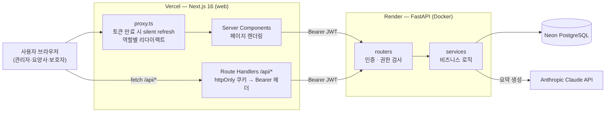
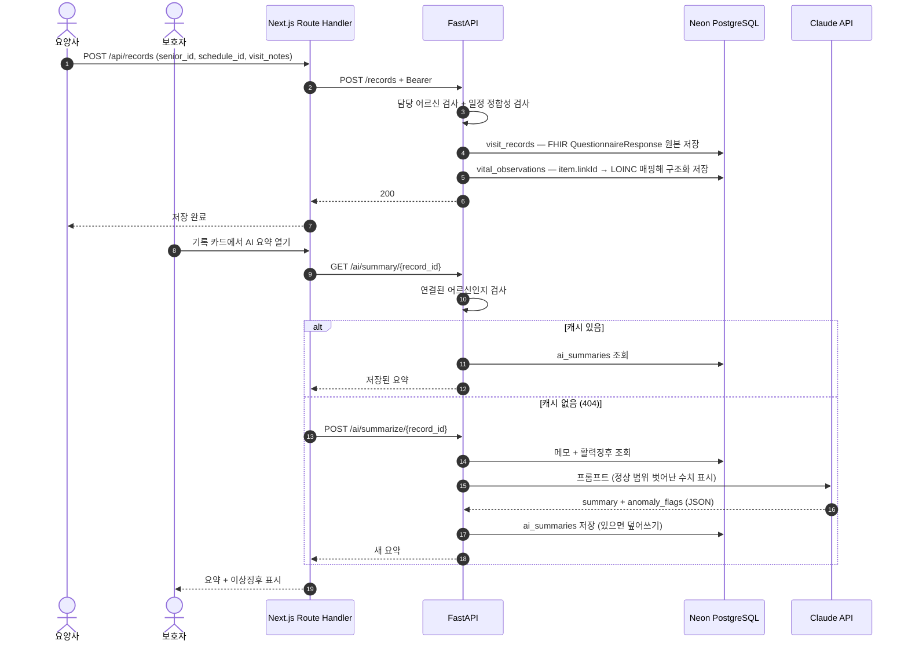

# 우리 동네 시니어 케어 매니저 — Backend

> 방문요양·건강기록 관리 SaaS | FHIR R5 기반 헬스케어 플랫폼


---

## 프로젝트 개요

고령화 사회를 반영한 방문요양 서비스 관리 플랫폼이다.
보호자·요양사·관리자 3개 역할 기반으로 방문 일정 매칭, FHIR 표준 건강기록 저장, AI 이상징후 감지를 제공한다.

### 핵심 기능

| 기능 | 설명 |
|------|------|
| 역할 기반 접근 제어 | admin / caregiver / guardian 3개 역할, JWT + Refresh Token |
| 어르신 단위 접근 검사 | 보호자는 연결된 어르신, 요양사는 담당 어르신만 (IDOR 방어) |
| 방문 일정 관리 | 요양사 ↔ 어르신 매칭, 일정 상태 관리 |
| FHIR 건강기록 | 방문 기록을 QuestionnaireResponse(JSON)로 원본 저장 |
| 활력징후 구조화 | LOINC 코드 기반 Observation 추출 → 추이 그래프용 |
| AI 요약 | 방문 메모 + 활력징후 → Claude API 요약 + 이상징후 하이라이트 (기록 단위 / 어르신 누적 단위) |

---

## 기술 스택

| 영역 | 기술 |
|------|------|
| Framework | FastAPI 0.129 (Python 3.11) |
| AI | Anthropic Claude claude-sonnet-4-20250514 |
| 인증 | JWT (python-jose) + bcrypt, Refresh Token(sha256 해시 저장) |
| DB | SQLAlchemy 2.0 / SQLite (로컬·테스트) / Neon PostgreSQL (운영) |
| 데이터 검증 | Pydantic v2 |
| FHIR 표준 | FHIR R5 QuestionnaireResponse + Observation (LOINC) |
| 테스트 | pytest + FastAPI TestClient (SQLite 인메모리) |
| 배포 | Render (Docker) — 프론트는 Vercel |

---

## 아키텍처

### 시스템 구성



- 브라우저는 FastAPI를 직접 부르지 않는다. 토큰은 httpOnly 쿠키에만 두고, Next.js 서버(Server Component·Route Handler)가 쿠키를 꺼내 `Authorization` 헤더로 바꿔 전달한다 — 브라우저 JS에서 토큰을 읽을 수 없게 하기 위함.
- 권한 검사는 전부 FastAPI `routers/`에서 한다. 프론트의 역할별 리다이렉트는 화면 이동용일 뿐 보안 경계가 아니다.

### 방문 기록 저장 → AI 요약 흐름



- **이중 저장**: QuestionnaireResponse 원본은 표준 그대로 보존하고, 활력징후만 따로 꺼내 LOINC 코드로 행 단위 저장한다. 원본은 다른 시스템과 주고받을 때, 구조화된 행은 추이 그래프·이상징후 계산에 쓴다.
- **현재 한계**: web의 기록 작성 화면은 메모만 받고 `fhir_response`를 빈 객체로 보낸다. 그래서 활력징후 추출(5번 단계)은 지금 API를 직접 호출할 때만 동작한다. 요약은 메모만으로 생성된다.

### 운영 메모

- Render 무료 인스턴스는 유휴 시 잠들어 첫 요청에 수십 초가 걸릴 수 있다(콜드 스타트).
- Neon도 유휴 시 잠들기 때문에 엔진에 `pool_pre_ping=True`를 켜 두었다.

---

## 프로젝트 구조

```
backend/
├── main.py                      # FastAPI 앱 진입점, CORS 설정, 테이블 생성
├── models.py                    # SQLAlchemy ORM 모델
├── auth.py                      # JWT 생성/검증, bcrypt, refresh token 해시
├── config.py                    # .env 환경변수 로드
├── database.py                  # DB 엔진 + 세션 의존성
├── routers/
│   ├── users.py                 # 회원가입·로그인, 역할 의존성, check_senior_access
│   ├── auth.py                  # refresh / logout
│   ├── seniors.py               # 어르신 CRUD + 보호자 관계
│   ├── schedules.py             # 방문 일정 관리
│   ├── records.py               # 방문 기록 (FHIR QR)
│   ├── vitals.py                # 활력징후 추이 조회
│   └── ai.py                    # LLM 요약 + 이상징후
├── services/
│   ├── access_service.py        # 요양사 ↔ 어르신 "담당" 관계 정의 (일정 기반)
│   ├── auth_service.py          # refresh token 갱신·폐기
│   ├── user_service.py
│   ├── senior_service.py
│   ├── schedule_service.py
│   ├── record_service.py        # FHIR QR 저장 + vital 자동 추출
│   ├── vital_service.py
│   └── ai_service.py            # Claude API 연동
├── schemas/                     # Pydantic 요청/응답 모델
└── tests/
    ├── conftest.py              # SQLite 인메모리 DB, 역할별 토큰·고정 데이터
    └── test_permissions.py      # 권한 회귀 테스트
```

---

## 데이터 모델

```
users                     → role: admin | caregiver | guardian
seniors                   → 돌봄 어르신 프로파일
guardian_senior_relations → 보호자 ↔ 어르신 N:M
visit_schedules           → 방문 일정 (caregiver ↔ senior)
visit_records             → FHIR QuestionnaireResponse (JSON 원본)
vital_observations        → FHIR Observation + LOINC 코드 (구조화)
ai_summaries              → 기록 단위 LLM 요약 + 이상징후 캐시
senior_ai_summaries       → 어르신 단위 누적 요약 (upsert)
refresh_tokens            → refresh token 해시 (다중 기기)
```

### 활력징후 LOINC 코드

| 항목 | LOINC | 단위 |
|------|-------|------|
| 혈압(수축기) | 8480-6 | mmHg |
| 혈압(이완기) | 8462-4 | mmHg |
| 맥박 | 8867-4 | beats/min |
| 체온 | 8310-5 | Cel |
| 혈당 | 2339-0 | mg/dL |
| 체중 | 29463-7 | kg |
| SpO₂ | 59408-5 | % |

---

## 역할별 권한

"담당"은 그 요양사에게 해당 어르신의 방문 일정이 하나 이상 있다는 뜻이다 (일정 기반 담당, `services/access_service.py`).
"연결"은 `guardian_senior_relations`에 보호자-어르신 관계가 있다는 뜻이다.

| 기능 | admin | caregiver | guardian |
|------|:-----:|:---------:|:--------:|
| 계정 생성 (관리자·보호자) | ✅ | - | - |
| 어르신 등록/수정/삭제, 보호자 연결 | ✅ | - | - |
| 어르신 조회 | 전체 | 담당 | 연결 |
| 일정 생성/수정/삭제 | ✅ | - | - |
| 일정 조회 | 전체 | 본인 일정 | 연결된 어르신 일정 |
| 일정 상태 변경 | ✅ | 본인 일정 | - |
| 방문 기록 작성 | ✅ | 담당 어르신 + 본인 일정 | - |
| 방문 기록·활력징후 조회 | 전체 | 담당 어르신 (작성자 무관) | 연결 |
| AI 요약 생성·조회 | 전체 | 담당 | 연결 |

- 권한이 없는 단건 조회는 **403**, 목록 조회는 범위 밖 데이터를 **필터로 제외**한다.
- `POST /register`는 body의 role과 상관없이 **caregiver로 고정**된다.
- 위 규칙은 `tests/test_permissions.py`로 회귀 테스트된다.

---

## 시작하기

### 요구사항
- Python 3.11+ (배포 이미지는 `python:3.11-slim`)
- Anthropic API Key

### 설치

```bash
git clone <repo-url>
cd backend

python -m venv venv
source venv/bin/activate  # Windows: venv\Scripts\activate

pip install -r requirements-dev.txt   # 앱 의존성 + pytest
```

### 환경변수 설정

```bash
cp .env.example .env
```

```env
ANTHROPIC_API_KEY=your_anthropic_api_key
SECRET_KEY=your_secret_key
ALGORITHM=HS256
ACCESS_TOKEN_EXPIRE_MINUTES=30
DATABASE_URL=sqlite:///./items.db          # 로컬
# DATABASE_URL=postgresql://<user>:<password>@<host>/<db>?sslmode=require   # Neon
CORS_ORIGINS=http://localhost:3000,http://localhost:3001
```

### 서버 실행 (로컬 — SQLite)

```bash
uvicorn main:app --reload
```

API 문서: `http://localhost:8000/docs`

### 테스트

```bash
pytest
```

- 운영 DB와 분리된 SQLite 인메모리 DB를 테스트마다 새로 만든다.
- Claude API는 호출하지 않는다 (권한 검사가 LLM 호출 전에 끝나는 경로만 검증).

---

## 배포

| 구성 | 서비스 | 비고 |
|------|--------|------|
| 백엔드 | Render (Web Service, Docker) | `Dockerfile` 사용, `PORT` 환경변수로 포트 지정 |
| DB | Neon PostgreSQL | `DATABASE_URL`에 `sslmode=require` |
| 프론트엔드 | Vercel | `CORS_ORIGINS`에 Vercel 도메인 등록 |

- 환경변수는 Render 대시보드에서 주입한다 (`.env`는 이미지에 포함되지 않음 — `.dockerignore`).
- 테이블은 앱 시작 시 `create_all`로 생성된다. 기존 테이블의 컬럼 변경은 자동 반영되지 않는다.

### 로컬 Docker (선택)

`docker-compose.yml`은 로컬에서 PostgreSQL 15 컨테이너와 함께 띄워 보는 용도다.

```bash
# .env의 DATABASE_URL을 postgresql://myuser:mypassword@db:5432/mydb 로 변경 후
docker-compose up --build
```

---

## API 엔드포인트

| Method | Path | 권한 | 설명 |
|--------|------|------|------|
| POST | `/register` | - | 요양사 회원가입 (role은 caregiver 고정) |
| POST | `/login` | - | 로그인 → access + refresh token |
| POST | `/auth/refresh` | - | refresh token → 새 access token |
| POST | `/auth/logout` | - | refresh token 폐기 |
| GET | `/me` | 인증 | 내 정보 |
| POST | `/admin/users` | admin | 계정 생성 (보호자는 `senior_ids` 필수) |
| GET | `/admin/users` | admin | 전체 유저 목록 |
| PATCH | `/admin/users/{id}/deactivate` | admin | 계정 비활성화 |
| GET | `/seniors` | 인증 | 어르신 목록 (역할별 범위) |
| GET | `/seniors/{id}` | 인증 + 접근 검사 | 어르신 상세 |
| POST/PUT/DELETE | `/seniors`, `/seniors/{id}` | admin | 어르신 등록·수정·삭제 |
| POST/GET | `/seniors/{id}/guardians` | admin | 보호자 연결 등록·조회 |
| GET | `/schedules` | 인증 | 방문 일정 목록 (역할별 범위) |
| GET | `/schedules/{id}` | 인증 + 접근 검사 | 일정 상세 |
| POST/PUT/DELETE | `/schedules`, `/schedules/{id}` | admin | 일정 생성·수정·삭제 |
| PATCH | `/schedules/{id}/status` | admin, 담당 요양사 | 일정 상태 변경 |
| GET | `/records` | 인증 | 방문 기록 목록 (역할별 범위) |
| GET | `/records/{id}` | 인증 + 접근 검사 | 방문 기록 상세 |
| POST | `/records` | admin, 담당 요양사 | 방문 기록 작성 |
| GET | `/records/{id}/vitals` | 인증 + 접근 검사 | 기록별 활력징후 |
| GET | `/vitals/seniors/{id}` | 인증 + 접근 검사 | 어르신 활력징후 추이 |
| POST | `/ai/summarize/{record_id}` | 인증 + 접근 검사 | 기록 AI 요약 생성 |
| GET | `/ai/summary/{record_id}` | 인증 + 접근 검사 | 기록 AI 요약 조회 |
| POST | `/ai/senior-summary/{senior_id}` | 인증 + 접근 검사 | 어르신 누적 요약 생성 |
| GET | `/ai/senior-summary/{senior_id}` | 인증 + 접근 검사 | 어르신 누적 요약 조회 |
